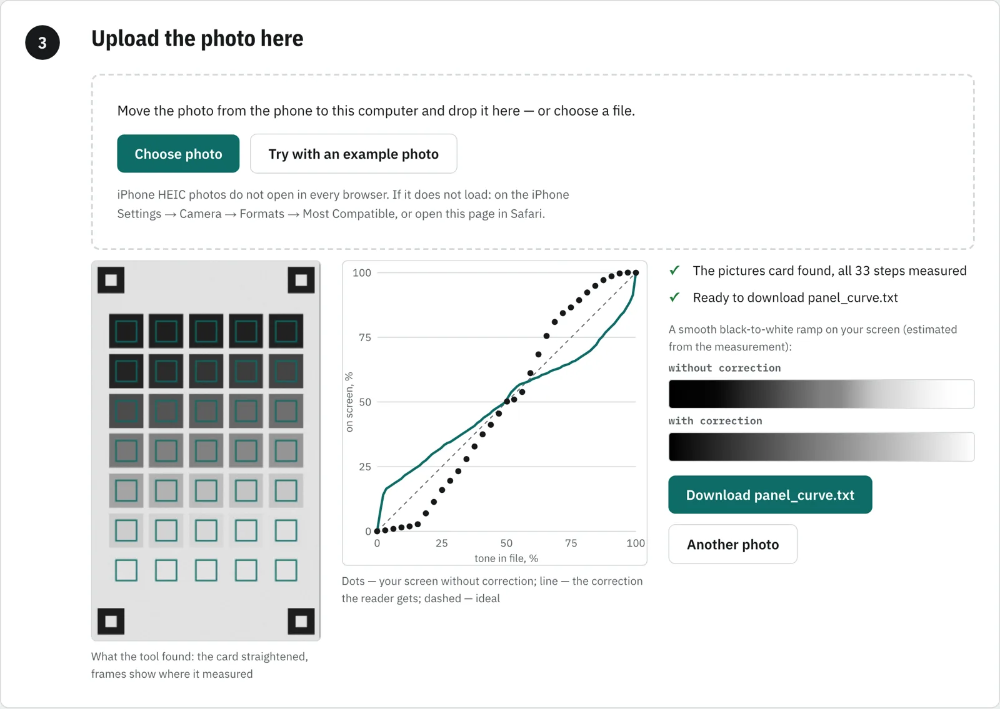
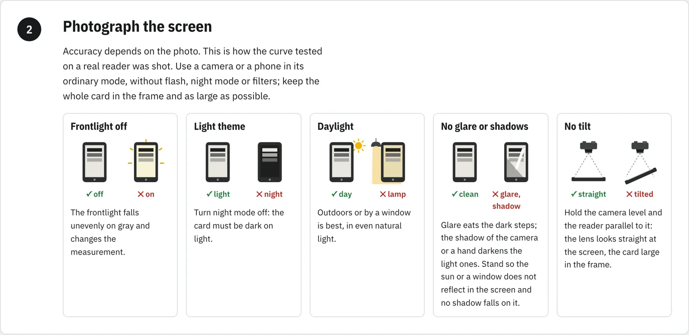
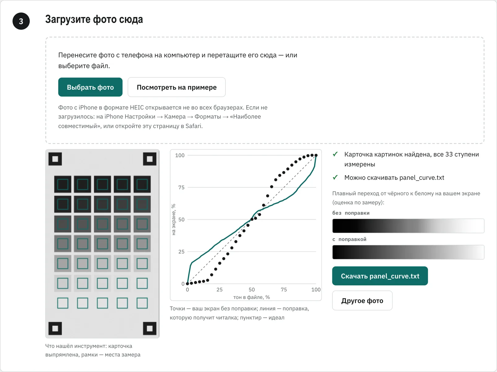
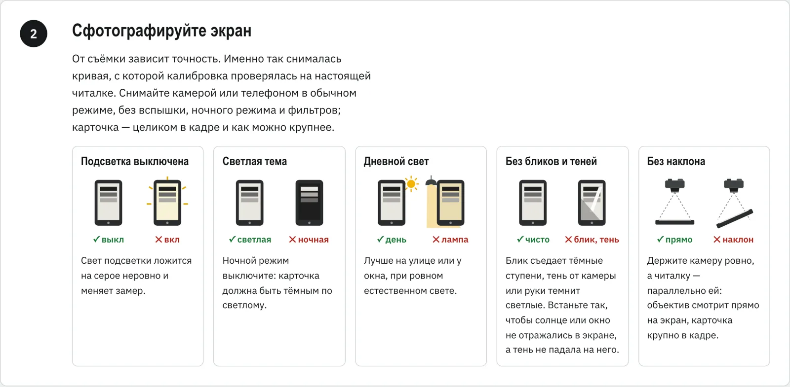

<h2 align="center">KEINKT</h2>

  
  &nbsp;
  

<b>Krinik E-Ink Tools</b> 
Browser tools for e-ink readers: calibrate the screen's gray tones from a photo, prepare pictures for the panel

<i>Dedicated to my mother, Sofia Fadeevna Kryvusha — a great reader and lover of books, who gave me my love of reading.</i>

  
  
  
  
  

[Читать по-русски →](#russian)

**KEINKT** is a set of small tools for people who read on e-ink. Each tool is one HTML file: download it from
[Releases](../../releases), open it with a double click, and it works in the browser — no install, no account, no
server. The code is plain JavaScript modules built into the page (`<script type="module">`); a library a tool may need
is baked into the file too — no npm, nothing fetched at run time. Nothing you load into a tool leaves your computer.

> **Built for the Xteink X4 Pro and CrossPoint.** The tools are developed and tested on the **Xteink X4 Pro** and are
> closely tied to the [CrossPoint Reader](https://github.com/crosspoint-reader/crosspoint-reader) firmware — in
> particular to its much-improved fork [**krinik**](https://github.com/MikalaiKryvusha/crosspoint-reader), which draws
> the calibration screens, reads the curves and shows pictures in gray through them. Other readers and firmwares may
> work; they are not tested.

| Tool | What it does | State |
|---|---|---|
| **KEINKT Calibrator** | Measures how your e-ink screen really shows grays, from one phone photo, and gives the reader a correction curve | in development |
| **KEINKT Image Editor** | Crops and prepares pictures and sleep screens for the reader's screen | planned |

  

  

### KEINKT Calibrator

Every e-ink panel shows grays its own way: one crushes the shadows, another washes out the light tones. A photo
prepared on a computer looks different on the reader. The calibrator measures your panel and gives the reader a
correction, so pictures and sleep images look the way they do on a computer.

1. On the reader: **Settings → Display → Screen calibration** → the pictures (or books) calibration screen. The reader
   draws a card of 33 gray steps and four corner marks.
2. Photograph the screen: frontlight off, light theme, daylight, no glare or shadows, camera level and the reader
   parallel to it. The page shows each condition as a do / don't drawing.
3. Drop the photo into the page. It finds the marks, straightens the perspective, works out the rotation, evens out
   the light against the paper and the black marks, measures the 33 steps and computes the curve.
4. Download `panel_curve.txt` (or `panel_curve_book.txt` for images in books), put it into the root of the memory card,
   turn the checkbox on in **Screen calibration**, put the reader to sleep and wake it.
5. Optional: open the same calibration screen again — now with the correction — photograph it, and the page shows how
   evenly the tones fall.

If the marks are not found automatically, you click them by hand; night mode, glare, tilt and overexposure are told
apart and explained. The page speaks English and Russian (more languages are coming).

Requires the CrossPoint **krinik** firmware with screen calibration (Xteink X4 / X4 Pro). The curve is a plain text file
of 256 numbers, so other firmwares can adopt it.

### KEINKT Image Editor

Planned: crop to the screen, tone for the measured panel curve, preview as the reader shows it, save a file the reader
opens as is. It replaces the command-line scripts used so far.

### Development

- `calibrator/index.html` — the tool itself; the analysis core sits between `CORE-BEGIN` and `CORE-END`.
- `node calibrator/test.mjs` — the core on synthetic photos with a known panel response: straight, rotated, upside down
  with perspective, tilted with uneven light, small in the frame, night mode, manual marks, both card kinds.
- `calibrator/design/flow-map.html` — screens and flows of the tool, laid out with
  [KUIPS](https://github.com/MikalaiKryvusha/KUIPS) from the page itself.

### Licence

MIT — see [LICENSE](LICENSE).

---

<h2 align="center">KEINKT</h2>

  
  &nbsp;
  

<b>Krinik E-Ink Tools</b> 
Браузерные инструменты для e-ink читалок: калибровка серых тонов экрана по фото и подготовка картинок под экран

<i>Проект посвящён моей маме — Кривуше Софии Фадеевне, очень большому читателю-книголюбу, которая привила мне любовь к чтению книг.</i>

[Read in English →](#english)

**KEINKT** — набор небольших инструментов для тех, кто читает с e-ink. Каждый инструмент — один HTML-файл: скачайте его
из [релизов](../../releases), откройте двойным щелчком, и он работает в браузере — без установки, учётной записи и
сервера. Код — обычные JavaScript-модули, встроенные в страницу (`<script type="module">`); библиотека, если инструменту
она понадобится, тоже вшивается в файл — без npm и без загрузок во время работы. Всё, что вы в него загружаете,
остаётся на вашем компьютере.

> **Сделано под Xteink X4 Pro и CrossPoint.** Инструменты разрабатываются и тестируются на **Xteink X4 Pro** и тесно
> завязаны на прошивку [CrossPoint Reader](https://github.com/crosspoint-reader/crosspoint-reader) — в частности на её
> сильно улучшенный форк [**krinik**](https://github.com/MikalaiKryvusha/crosspoint-reader): он рисует калибровочные
> экраны, читает кривые и показывает картинки в сером через них. Другие читалки и прошивки могут работать, но не
> тестируются.

| Инструмент | Что делает | Состояние |
|---|---|---|
| **KEINKT Calibrator** | Измеряет по одному фото, как ваш e-ink экран на самом деле показывает серые тона, и даёт читалке кривую поправки | в разработке |
| **KEINKT Image Editor** | Кроп и подготовка картинок и заставок под экран читалки | в планах |

  

  

### KEINKT Calibrator

Каждая e-ink панель показывает серое по-своему: одна темнит тени, другая сливает светлые тона. Фото, подготовленное на
компьютере, на читалке выглядит иначе. Калибратор измеряет вашу панель и даёт читалке поправку, чтобы картинки и
заставки выглядели так же, как на компьютере.

1. На читалке: **Настройки → Экран → Калибровка экрана** → калибровочный экран картинок (или книг). Читалка рисует
   карточку из 33 серых ступеней и четырёх угловых меток.
2. Сфотографируйте экран: подсветка выключена, светлая тема, дневной свет, без бликов и теней, камера ровно, читалка
   параллельно ей. Каждое условие страница показывает рисунком «так / не так».
3. Перетащите фото на страницу. Она найдёт метки, выпрямит перспективу, определит поворот, выровняет свет по бумаге и
   чёрным меткам, измерит 33 ступени и рассчитает кривую.
4. Скачайте `panel_curve.txt` (или `panel_curve_book.txt` для картинок в книгах), положите в корень карты памяти,
   включите галочку в **Калибровке экрана**, усыпите и разбудите читалку.
5. По желанию: откройте тот же калибровочный экран — уже с поправкой — сфотографируйте, и страница покажет, насколько
   ровно легли тона.

Если метки не нашлись сами, их можно указать вручную; ночной режим, блик, наклон и пересвет распознаются и объясняются.
Страница говорит по-английски и по-русски (другие языки — следом).

Нужна прошивка CrossPoint **krinik** с калибровкой экрана (Xteink X4 / X4 Pro). Кривая — обычный текстовый файл из 256
чисел, другие прошивки могут её подхватить.

### KEINKT Image Editor

В планах: кроп под экран, тон под измеренную кривую панели, предпросмотр как на читалке, сохранение файла, который
читалка открывает как есть. Заменит скрипты командной строки, которыми картинки готовились до сих пор.

### Разработка

- `calibrator/index.html` — сам инструмент; ядро анализа — между `CORE-BEGIN` и `CORE-END`.
- `node calibrator/test.mjs` — ядро на синтетических фото с известной кривой панели: прямо, боком, вверх ногами с
  перспективой, под наклоном с неровным светом, мелко в кадре, ночной режим, ручные метки, оба вида карточки.
- `calibrator/design/flow-map.html` — экраны и переходы инструмента, разложенные [KUIPS](https://github.com/MikalaiKryvusha/KUIPS)
  по самой странице.

### Лицензия

MIT — см. [LICENSE](LICENSE).
